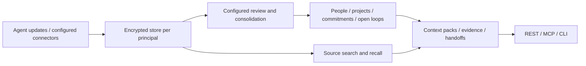

# ShogunAgent

**AI エージェントのための状態レイヤー**：人、プロジェクト、約束、未完了の仕事を、根拠となる出典と承認の仕組みとともに共有します。

ShogunAgent は、複数のエージェントが同じ暗号化された作業履歴とレビュー済みの状態を、REST、MCP、CLI から使えるようにします。会話やタスクの更新を保存し、その出典を取り出せます。処理を設定すれば、何が変わり、何がまだ残っているかも追えます。結果を伴う外部への行動には、人間の承認が必要です。

[クイックスタート](#クイックスタート出典を保存して取り出す) · [エージェントをつなぐ](docs/local-agent-setup.md) · [状態のウォークスルー](docs/local-state-walkthrough.md) · [API リファレンス](docs/api/core-tools.md) · [リリース](https://github.com/Torutesu/Shogunagent/releases) · [English](README.md)

## 現在使えるもの

提供状況は **2026 年 10 月 28 日**に確認しました。これはローカルの開発者プレビューです。ソースの公開、成果物の公開、ホスト型サービスは別々の節目です。

| 経路 | いま使えるもの | 始め方 |
|---|---|---|
| ソースからのビルド | Linux と macOS の Rust エンジン。最新の導入スクリプトはこのリポジトリにある | [下のクイックスタート](#クイックスタート出典を保存して取り出す) |
| Linux バイナリ | x86_64 と ARM64 の `v0.1.0` アーカイブと SHA-256 ファイル。**glibc 2.39 以上**が必要 | [リリースをダウンロード](https://github.com/Torutesu/Shogunagent/releases/tag/v0.1.0)。展開前にチェックサムを確認する |
| コンテナ | 公開済みの `ghcr.io/torutesu/shogunagent:v0.1.0`。Linux AMD64 と ARM64。匿名アクセスを確認済み | `docker pull ghcr.io/torutesu/shogunagent:v0.1.0` のあと、[デプロイ設定](deploy/README.md) |
| CLI と SDK のパッケージ | コードはある。npm の `shogunagent`、npm の `@shogunagent/sdk`、PyPI の `shogunagent` は**未公開** | 下にリンクしたソースの手順を使う。`npx` と `pip` は現在の導入方法ではない |
| ホスト型 API と連携 | ゲートウェイ、課金、コネクタの実装はリポジトリにある。公開のホスト型アクセスは未確認 | 運用者の設定とプロバイダの認証情報が必要。ホスト名が設定されていても、サービスが動いているとは限らない |

リリースは現在の `main` より古いソースのリビジョンに固定されています。新しいブリッジとウォークスルーのスクリプトを使うには、リポジトリのチェックアウトが必要です。macOS と Windows のバイナリは公開していません。macOS ではソースからビルドできますが、Windows の手順はここでは扱いません。画面や会議の取得は別の [ShogunAI Mac アプリ](docs/MIGRATION.md)が行います。このサーバーは画面や会議を取得しません。

## クイックスタート：出典を保存して取り出す

このローカルの例では、**合成したテキストを使い、モデルを呼ばず、ホスト型のアカウントも使いません**。認証付きの保存と取り出しができることを確かめます。サイトの図にあるような、人・プロジェクト・約束の豊かな状態を自動で抽出するものではありません。

前提：Git、Rust stable、ネイティブの C/C++ ツールチェーン、Python 3、curl。Linux では `clang` と `pkg-config` も必要です。macOS ではコマンドラインの開発者ツールが必要です。コンパイルには数 GB のディスクを見込んでください。この Rust / REST の例に Node と pnpm は要りません。

### 1. サーバーをビルドする

```sh
git clone https://github.com/Torutesu/Shogunagent.git
cd Shogunagent
cargo build --release --locked -p shogun-core \
  --features daemon-server --bin shogun-api --bin shogun-mcp
```

`CARGO_TARGET_DIR` を設定している場合は、下の `./target/release` の代わりにその `release` ディレクトリを使ってください。検証済みの Linux アーカイブがあれば、展開した `shogun-api` を代わりに使えます。その場合も、ドキュメントとクライアント用ブリッジのためにチェックアウトは残してください。

### 2. 評価用の秘密鍵を作る

リポジトリの直下で一度だけ実行します。既に `.shogun-demo` ディレクトリがあれば実行を拒み、既存の鍵を置き換えることはありません。このディレクトリは Git の対象外です。

```sh
(
  set -eu
  umask 077
  mkdir .shogun-demo
  python3 - <<'PY'
import os, secrets
for name, size in [('db.key', 32), ('api.token', 24)]:
    fd = os.open('.shogun-demo/' + name,
                 os.O_WRONLY | os.O_CREAT | os.O_EXCL, 0o600)
    with os.fdopen(fd, 'w') as out:
        out.write(secrets.token_hex(size) + '\n')
PY
)
```

2 つのファイルは他人に見せないでください。暗号化されたストアを開き直すにはデータベースの鍵が必要です。鍵を置き換えても、既存のストアがリセットされたり開けるようになったりはしません。鍵やトークンを、クライアントの設定、チャット、ログ、Git に貼らないでください。

### 3. ローカルサーバーを起動する

```sh
(
  set -eu
  export SHOGUN_DB_KEY_DEMO="$(cat .shogun-demo/db.key)"
  export SHOGUN_PRINCIPAL_TOKENS="demo:$(cat .shogun-demo/api.token):website-demo"
  export SHOGUN_API_PORT=7464
  ./target/release/shogun-api \
    --multi "$PWD/.shogun-demo/principals" --key-provider env
)
```

このターミナルは動かしたままにします。API は `127.0.0.1:7464` で待ち受けます。画面のあるダッシュボードではありません。複数 principal モードでは、最初に認証付きでアクセスしたときに暗号化された `demo` ストアが作られます。環境変数の鍵プロバイダは評価用です。本番の鍵プロバイダとネットワークは[デプロイの手順](deploy/README.md)で扱います。

### 4. 内容を保存して、取り出す

**2 つ目のターミナル**で同じリポジトリのディレクトリに入り、次を実行します。

```sh
(
  set -eu
  SHOGUN_DEMO_TOKEN="$(cat .shogun-demo/api.token)"
  curl --fail-with-body --silent --show-error \
    http://127.0.0.1:7464/v1/memory/ingest \
    -H "Authorization: Bearer $SHOGUN_DEMO_TOKEN" \
    -H 'Content-Type: application/json' \
    --data '{"source":"website-demo","actor":"agent:website-demo","thread_key":"kestrel-demo","idempotency_key":"kestrel-demo-v1","events":[{"content":"The Kestrel demo codeword is violet."}]}'
  printf '\n'
  curl --fail-with-body --silent --show-error \
    http://127.0.0.1:7464/v1/memory/recall \
    -H "Authorization: Bearer $SHOGUN_DEMO_TOKEN" \
    -H 'Content-Type: application/json' \
    --data '{"query":"Kestrel","budget_tokens":1000}'
  printf '\n'
)
```

**成功の目安**：取り込みが 1 件の挿入を報告し、recall の出典に “The Kestrel demo codeword is violet.” が含まれます。同じ取り込みをもう一度送ると、新しいイベントは挿入されず、再送として返ります。この段階で型付き状態の `items` が空なのは想定どおりです。検索できる出典の履歴と、レビュー済みの状態は別の出力です。

サーバーは Ctrl+C で止めます。保存したデータを使い続けるには、同じ鍵ファイルで手順 3 から起動し直してください。鍵の作成は繰り返さないでください。

| こう表示されたら | 確認すること |
|---|---|
| Connection refused | 1 つ目のターミナルでサーバーが動いていて、ポートが合っているか |
| Port already in use | 競合しているプロセスを止めるか、別の `SHOGUN_API_PORT` を選んで URL を合わせる |
| HTTP 401 | このサーバーを設定した秘密のトークンファイルを使っているか |
| `.shogun-demo` already exists | 元の鍵のまま再利用するか、全手順を通して別の評価用ディレクトリを使う |
| 出典は出るが、人やプロジェクトが出ない | 処理を設定する。取り込みが成功しても、抽出が終わったわけではない |

## コーディングエージェントをつなぐ

クイックスタートのサーバーを動かしたまま、モデルを呼ばずに MCP を確認します。

```sh
python3 scripts/mcp-local-bridge.py \
  --token-file "$PWD/.shogun-demo/api.token" --check
```

初期化、ツール一覧、本人確認がすべて PASS になれば正常です。[クライアントの設定手順](docs/local-agent-setup.md)に沿って、Claude Code、Cursor、Codex、Claude Desktop 向けの設定を作ってください。ブリッジは保護されたトークンファイルを読み、サーバーがリクエストごとに求める MCP のヘッダーを付けます。生成される設定に入るのはパスだけで、トークンの値は入りません。提案された設定を確認し、ほかの MCP サーバーの設定は残してください。

**権限は接続によって変わります。** このブリッジはトークンの権限をそのまま使うので、デモ用トークンで許される書き込みもできます。古い [Node CLI の stdio アダプタ](packages/cli/README.md)は読み取り専用で、既存の単一ストアのデータベースと対応する鍵が必要です。その自動の `connect` コマンドは npm を前提にした設定を書くので、上のソースだけで動くブリッジの設定とは別物です。

| 連携 | リポジトリ内の手順 |
|---|---|
| ローカルの MCP クライアント | [接続、設定、トラブルシューティング](docs/local-agent-setup.md) |
| REST / HTTP の MCP | [主要ツール](docs/api/core-tools.md)、[MCP の通信](docs/memory-api-mcp.md) |
| TypeScript / Python | [TypeScript SDK](packages/sdk-ts/README.md)、[Python SDK](packages/sdk-py/README.md)。フレームワーク向けアダプタはソースのパッケージ |
| エージェント間の引き継ぎ | [作成と受け入れの契約](docs/api/handoff.md) |
| エクスポートと可搬性 | [Export v2](docs/api/export-v2.md)、[変換ツール](packages/interop/README.md) |
| ルーターとコネクタ | [ルーター](apps/router/README.md)、[コネクタの形式](apps/router/connectors/schema.md) |

## 出典からレビュー済みの状態へ



- **データを持つのは Rust です。** 出典、状態、根拠、権限の判断はエンジンの中にあります。principal ごとに別々の SQLCipher ストアを持ちます。
- **処理は明示的に設定します。** 本番のレビュー経路には Batch 中継の認証情報の設定が必要です。基本のクイックスタートはそれなしで動きます。レビューは完了した 1 時間ごとの窓を対象にし、抽出された人やプロジェクトは、2 つの 1 時間のセッションに根拠があって初めて通常どおり表示されます。1 回だけ実行する `--dream-tick` コマンドは、定期実行の仕組みではありません。
- **根拠と確信度が大事です。** recall は、日付付きの出典の履歴と、対象となる現在の状態を分けて返します。レビュー済みのループの主張には、一致する出典の引用が必要です。過去に取り込んだ根拠には引用がない場合があります。確信度の低い候補は、確定した事実として扱いません。
- **行動には権限の段階があります。** L1 は読み取りと、許可されたローカルの取り込みです。L2 の操作には確認が要り、L3 の外部への行動には人間の承認が要ります。無料の読み取りにも認証と範囲の確認がかかります。承認されたことは、外部への送信が成功した証拠ではありません。
- **ホスティングは別の層です。** `apps/api` はゲートウェイの認証、計量、中継を受け持ち、リクエストとレスポンスの本文を保存しない設計です。抽出を有効にすると、対象の内容は設定したプロバイダの経路に送られます。保存がローカルでも、設定したすべての処理が手元で完結するとは限りません。

再現できるエンジンのデモ：

```sh
cargo run --locked -p shogun-core --features daemon-server --example maya_handoff
```

これは本物の取り込み、レビューの解析、根拠の確認、recall、引き継ぎを、**台本どおりのモデル応答**で動かします。プロバイダの呼び出しや外部への送信はしません。[状態のウォークスルー](docs/local-state-walkthrough.md)で、このリプレイと、認証情報を使う別の処理経路を説明しています。

## 検証と制約

検証するリビジョンについては、[最新の CI 結果](https://github.com/Torutesu/Shogunagent/actions)を使ってください。固定したテスト件数は、すべてのチェックアウトを表すものではありません。

| 根拠 | 確かめられること | 確かめられないこと |
|---|---|---|
| [ローカルの導入とオンボーディングの監査](apps/web/VERIFICATION.md) | 新しいストアでの取り込み、recall、再起動、認証と再送の確認。ブリッジの通信の確認と、記録したクライアント接続の試行 | あらゆるクライアントとの互換性や、名前を挙げた各アプリでモデル駆動のツールが成功すること |
| [状態の品質の回帰スイート](docs/state-quality-eval.md) | 決められた応答のもとでの期限変更、完了、スヌーズと再開、根拠、再起動、分離 | 実モデルでの抽出の精度。既定の CI は人が書いた答えを使う |
| [Maya のリプレイ](docs/local-state-walkthrough.md) | エンジンを通した、出典に基づく状態と、受け手エージェントの scratch | 実際のモデル出力、ホスト型の中継の運用、本番での自動の定期実行 |
| [検索のベンチマーク](docs/benchmarks/README.md) | 名前を挙げたデータセットと設定での結果 | 競合との順位や、多言語の品質の一般的な保証 |
| サイトのプレイグラウンド、グラフ、ノートパソコンの場面 | 合成データを使った、ブラウザ上での説明用のワークフロー | 出荷済みのデスクトップのダッシュボードや、あなたのストアへの接続 |

10 月 27 日の開発中の確認では、[コミット `a26089f`](https://github.com/Torutesu/Shogunagent/commit/a26089f72a7a6c95b5a50c8203b7f0795e712756) 相当のソースに対して、**gpt-6-luna** の実際の応答を 6 回使いました。英語の合成シナリオ 1 本が、本番と同じリクエスト設定で、最初の約束、期限の変更、完了の確認を通りました。これは API のテスト用アダプタを通したローカルの狭い評価で、デプロイした中継でも精度のベンチマークでもありません。それ以前の別の設定での失敗も記録に残しています。現在の `main` で新たに実モデルの評価をしたわけではありません。決定的なテストと、任意で実行する実モデルの評価の違いは[評価の手順](docs/state-quality-eval.md)にあります。実モデルの呼び出しには許可されたアカウントが必要で、利用枠を消費することがあります。

その後の [Codex での文脈共有の検証](docs/codex-context-verification.md)では、新しい Codex CLI 0.164.0 のセッション 4 つが、実際の MCP 呼び出しを 7 回行いました。出典の保存、エンジンの再起動、新しいセッションでの取り出し、明示的な期限の変更の解釈です。[セットアップ用プロンプトの受け入れテスト](docs/setup-prompt-acceptance.md)では、セットアップ用エージェントが作ったプロジェクト設定を使い、作業セッション 4 つと MCP 呼び出し 11 回が受け入れられたことを記録しています。不要な書き込みの方針を直したあとは、最後の状態の読み取りが、その答えを新しい根拠として取り込むことはありませんでした。

これらは macOS 上の合成シナリオで、現在の main を新しくビルドしたものではなく、`4e8210f` で以前ビルドしたサーバーを使っています。recall の `facts` と `items` は空のままでした。モデルは取り出した出典の履歴を解釈しただけで、型付き状態の抽出、Batch 処理、型付きの引き継ぎ、本番のデプロイは試していません。セットアップには別のエンジン用ターミナルとクライアントの再起動が必要でした。最後のプロンプトは既存のテスト用プロジェクトで直して試し直したもので、まったく新しいマシンに入れ直したわけではありません。隔離した Codex での成功は以前のツールの失敗に代わる結果ですが、通常のクライアント設定が直ったことまでは示していません。[以前のクライアントの確認](apps/web/VERIFICATION.md#observed-client-results)では、Claude と Cursor でのモデル駆動の利用と、Claude Desktop はまだ確認できていません。

ローンチ時点での既知の制約：

- 公開のホスト型アクセス、本番の中継処理、コネクタの OAuth、課金、外部への送信は、それぞれ運用者による確認が必要です。ソースにある決済レールはスタブです。
- サイトの新しいクイックスタートは、直近の公開環境の確認で 404 を返しました。デプロイが確認できるまでは、この README とリポジトリ内の手順を使ってください。
- モデルの出力は、根拠のない引用や形式の崩れで拒否されることがあります。キーワード検索は、意味や言語をまたいだ再現を保証しません。任意のローカル埋め込みモデルには、別途セットアップと評価が必要です。
- 公開した Linux の成果物は、Windows や macOS のバイナリの対応を示すものではありません。プラットフォームごとのクライアントの動きは、使うマシンで確認が必要です。

## プロジェクトの方向性

ShogunAgent は、[ShogunAI](docs/MIGRATION.md) の状態と権限のエンジンを、エージェントとセルフホストのサービス向けに発展させたものです。重点は、共有された作業の状態、出典の根拠、持ち運べるエクスポート、制御された行動です。エンジンは Apache-2.0 ですが、運用にはインフラとモデルの費用がかかることがあります。ソースにあるホスト型の価格は推定で、購入できる提供ではありません。

Mem0、Graphiti/Zep、Letta、Supermemory には重なる機能があります。型付きの状態、時間に沿った検索、ローカルでの導入は、私たちだけの差別化要素ではありません。優位を主張する前に、具体的な版を比べ、同じハーネスで評価してください。プロダクトの方針は [docs/strategy.ja.md](docs/strategy.ja.md)（[English](docs/strategy.md)）にあります。プロダクトの計画とオーナーの決定は、[実装計画](docs/implementation-plan.md)、[判断の記録](docs/decisions/)、[調査](research_notes/)にあります。ディレクトリへの提出、プロバイダへの登録、法務と運用者の情報、ホスト型の展開は、別のローンチ作業です。

## 開発と貢献

エンジンを変更する前に [CONTRIBUTING.md](CONTRIBUTING.md) と [CLAUDE.md](CLAUDE.md) を読んでください。JavaScript のワークスペースには Node.js 22 以上と、固定した pnpm のバージョンを使います。貢献の手引きにワークスペース全体のチェックがあります。手早くオフラインで確認するには：

```sh
python3 -m unittest discover -s scripts -p 'test_mcp_local_bridge.py'
cargo run --locked -p shogun-core --features daemon-server --example maya_handoff
node scripts/gen-llms-txt.mjs --check
```

README の変更は、生成されるエージェント向けドキュメントに反映されます。`node scripts/gen-llms-txt.mjs --write` で再生成し、生成ファイルを手で編集しないでください。英語版の README を変えたら、この日本語版も同じ内容に合わせてください。

| ディレクトリ | 役割 |
|---|---|
| `crates/` | Rust のエンジン、暗号化ストレージ、状態の処理、各インターフェース、評価用ハーネス |
| `apps/api/`、`apps/router/` | ゲートウェイと中継、ツールのルーティング |
| `apps/web/` | 静的サイトと合成データのデモ。ソースとデプロイは別 |
| `packages/cli`、`packages/sdk-ts`、`packages/sdk-py` | CLI、SDK、フレームワーク向けアダプタ |
| `docs/`、`deploy/` | API の契約、セットアップ、ベンチマーク、デプロイの手順書 |
| `scripts/`、`fuzz/`、`packages/conformance` | ガード、生成スクリプト、ファズのターゲット、プロトコルの確認 |

[セキュリティポリシー](SECURITY.md) · [ライセンス](LICENSE) · [移行の経緯](docs/MIGRATION.md)
